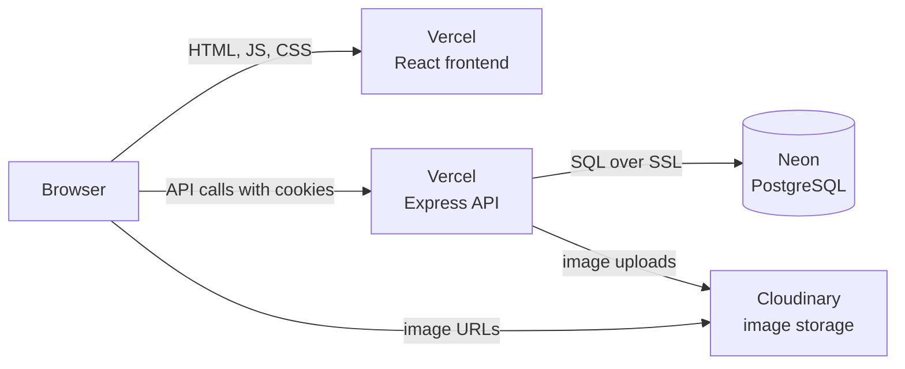
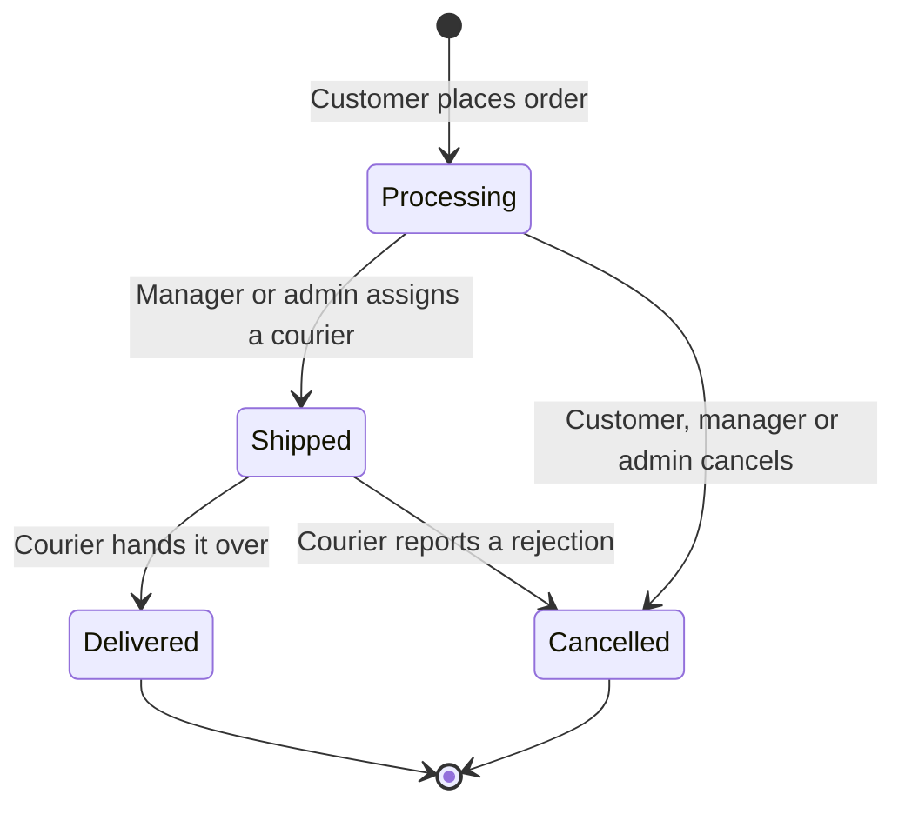
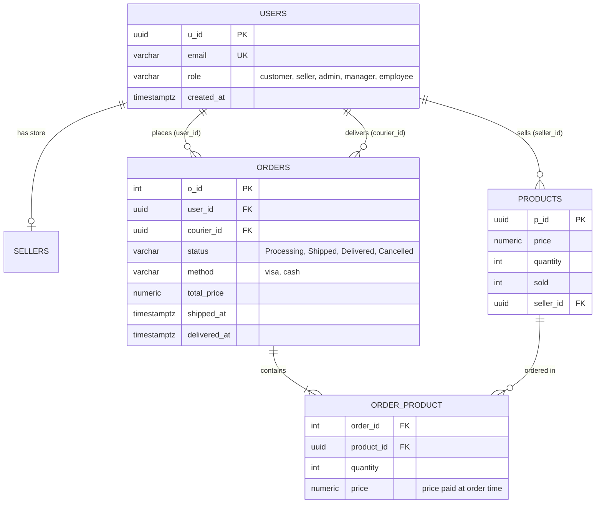

<div align="center">

# DarkZon

**A full-stack e-commerce platform with five user roles, three dashboards and a complete order-to-delivery flow.**


**[Live demo](https://darkzon-mu.vercel.app)** · **[Demo video](https://YOUR-VIDEO-LINK)**

</div>

> **Note:** DarkZon is a portfolio project, not a real store. No real payments are taken.

## Table of contents

- [Overview](#overview)
- [Features](#features)
- [Tech stack](#tech-stack)
- [Architecture and deployment](#architecture-and-deployment)
- [Order lifecycle](#order-lifecycle)
- [Database](#database)
- [Security](#security)
- [API overview](#api-overview)
- [Project structure](#project-structure)
- [Getting started](#getting-started)
- [Environment variables](#environment-variables)
- [Deploying](#deploying)
- [Demo accounts](#demo-accounts)
- [Screenshots](#screenshots)
- [Known limitations and roadmap](#known-limitations-and-roadmap)
- [What I learned](#what-i-learned)
- [Author](#author)

## Overview

DarkZon covers the whole life of an online order, from browsing a product to the courier handing it over at the customer's door. Five different roles use the same system, and each one gets the screens and permissions they need:

**customer → seller → manager → admin → delivery courier**

I built both the frontend and the backend, designed the database, and deployed everything to the cloud.

## Features

### By role

| Role | What they can do |
|---|---|
| **Customer** | Browse and filter products (category, price range, rating, stock, search, sort), see product pages with reviews, use a cart that works **without an account** and merges into the account after login, check out with cash or card, see order history with a progress line, edit the phone and address of an order that is still processing, cancel a processing order, manage the profile (photo, password, delete account), dark and light theme |
| **Seller** | Dashboard with revenue, earned money (delivered orders), units sold, a chart per day and per product, best sellers and stock alerts. Add, edit and delete products with multiple images and categories. See the orders that contain their products (without customer details) |
| **Manager** | "Needs attention" dashboard: orders waiting too long, deliveries out for too long, courier workload, low stock. Activity charts for a date range. Ship orders (choose a courier) and cancel orders. Read-only view of every courier and what they are delivering |
| **Admin** | Sales dashboard (revenue, average order, cancellation rate, top products, payment methods, users by role, per-day chart), role management with safety rules (you cannot change or delete yourself, the last admin is protected), and the same order tools as the manager |
| **Delivery courier** | A personal page with only the orders assigned to them. One tap to mark an order as **delivered**, or **rejected** (the order is cancelled and the stock returns). Cash orders show the amount to collect, with call and map shortcuts |

### Highlights

- **Order flow across roles:** a status machine (`Processing → Shipped → Delivered / Cancelled`) where every change is checked on the server for the right role and the right current status.
- **Data integrity:** stock changes and status changes happen together inside **database transactions** with row locks (`FOR UPDATE`), so a cancelled order always returns its stock exactly once.
- **Guest cart:** stored in the browser, then merged into the real cart when the visitor logs in or registers.
- **Real dashboards, not placeholders:** statistics are calculated in SQL (grouping, `generate_series` for per-day charts, filtered aggregates), with date ranges and server-side pagination.
- **Design system:** one theme file with CSS variables ("ink and lime" palette), full **dark mode**, and reusable components (button, input, modal, product card, order card, skeleton loaders) used on every page.
- **Good user experience:** skeleton loading screens, empty and error states with retry, toasts, form validation with inline messages, and keyboard and screen-reader friendly controls.
- **Contact page:** opens a pre-filled Gmail draft or a WhatsApp chat, with a mail-app fallback.

## Tech stack

| Layer | Technology |
|---|---|
| **Frontend** | React, React Router (HashRouter), Bootstrap 5.3, Recharts, custom CSS design tokens |
| **Backend** | Node.js, Express |
| **Database** | PostgreSQL (hosted on **Neon**) |
| **Authentication** | JSON Web Tokens (access and refresh tokens in httpOnly cookies), bcrypt |
| **Images** | Multer for uploads, **Cloudinary** for storage and delivery |
| **Security** | express-rate-limit, role-based access control, parameterized SQL queries |
| **Hosting** | **Vercel** for both the frontend and the backend |

## Architecture and deployment

Both the frontend and the backend are deployed on **Vercel**. The database lives on **Neon** and all uploaded images live on **Cloudinary**.



Why these services:

- **Vercel (frontend):** the React app is built to static files and served from a global CDN. The app uses `HashRouter`, so every page link works on static hosting without special rewrite rules.
- **Vercel (backend):** the Express API runs as serverless functions, so it needs no server to maintain and deploys with the frontend workflow. Because functions have no permanent disk, files can't be saved locally, which is why images go to Cloudinary.
- **Neon (database):** serverless PostgreSQL. It is standard Postgres, so every query, transaction and constraint behaves as it would on any other Postgres host. On the free plan it pauses after a few minutes without queries and wakes up automatically on the next request, so the very first request after a quiet period can be a little slower.
- **Cloudinary (images):** product and profile images are uploaded to Cloudinary, and the database stores the image reference. The CDN delivers them fast, and nothing depends on the server's file system.

## Order lifecycle



Every transition:

1. is allowed only for the right role (for example, only the assigned courier can finish a delivery),
2. is allowed only from the right current status (a delivered order can't be cancelled),
3. runs in one database transaction, and a cancellation returns the products to the stock.

## Database



Other tables: product images, categories (many-to-many with products), comments and ratings, and carts.

The database is created from SQL files in [`server/sql`](server/sql). Some design decisions worth mentioning:

- `CHECK` constraints protect important rules at the database level (allowed statuses, roles and payment methods, non-negative prices and quantities).
- `order_product.price` saves the price the customer paid, so a seller's old revenue does not change when they edit a product price later.
- Deleting a user keeps their orders (`ON DELETE SET NULL`), and the admin pages show "Deleted account".
- Indexes on order dates, statuses and couriers keep the dashboard queries fast.

## Security

- **Passwords** are hashed with bcrypt.
- **Tokens** live in **httpOnly cookies** (not readable by JavaScript): a 1-hour access token and a 30-day refresh token. In production the cookies are `secure`.
- **Role-based access control** is enforced on the server for every protected route. Hiding a button in the UI is never the only protection.
- **SQL injection:** every query is parameterized.
- **Rate limiting** with `express-rate-limit` on sensitive endpoints:

  | Endpoint | Limit |
  |---|---|
  | Login | 5 failed attempts per 15 minutes (per IP and email) |
  | Register | 5 per hour per IP |
  | Change password | 5 per 15 minutes per user |
  | Place order | 10 per minute per user |
  | Uploads | 40 per hour per user |
  | Dashboard statistics | 30 per minute per user |
  | Whole API | 600 per 15 minutes per IP |

- **Admin safety rules:** you can't change or delete your own account, and the last admin can't be removed.
- **Validation** on both the client and the server (dates, ids, statuses, roles).

## API overview

All routes start with `/api`. A short map of the main groups:

| Area | Examples |
|---|---|
| **Auth and users** | `POST /register/user`, `POST /register/seller`, `POST /login`, `POST /logout`, `GET /user`, `PATCH /user/edit/:id`, `PATCH /user/password` |
| **Products** | `GET /products`, `GET /products/:id`, `POST /product/add`, `PATCH /product/edit/:id`, `DELETE /product/delete/:id`, `GET /category` |
| **Comments** | `GET /comment/:productId`, `POST /comment/:productId` |
| **Cart** | `GET /cart`, `POST /cart/:productId`, `PATCH /cart/:productId`, `DELETE /cart/:productId` |
| **Orders (customer)** | `POST /order`, `GET /user/order`, `PATCH /order/:id` |
| **Admin** | `GET /admin/stats`, `GET /users`, `PATCH /role/edit/:id`, `DELETE /delete/user/:id` |
| **Admin and manager** | `GET /order`, `GET /admin/couriers`, `PATCH /admin/order/:id` (ship or cancel) |
| **Seller** | `GET /seller/stats`, `GET /seller/product`, `GET /seller/orders` |
| **Manager** | `GET /manager/stats`, `GET /manager/couriers` |
| **Delivery** | `GET /delivery/orders`, `PATCH /delivery/order/:id` (delivered or rejected) |

## Project structure

```text
.
├── client/                      # React app
│   └── src/
│       ├── components/          # Button, Input, Modal, Card, OrderCard, Nav, Footer, loading skeletons...
│       ├── pages/               # home, products, product, cart, pay, history, profile, login, register,
│       │                        # contact, delivery, sellerDashboard, adminDashboard, managerDashboard
│       ├── theme/               # theme.css (design tokens, light and dark) and the theme toggle
│       ├── utils/               # toast notifications and helpers
│       └── config.js            # API address
└── server/
    ├── controllers/             # user, product, cart, order, admin, seller, manager, delivery...
    ├── routes/                  # one router per area
    ├── middlewares/             # verifyToken, verifyRole, rate limiters, upload, error handling
    ├── config/                  # database connection
    ├── sql/                     # schema and migrations
    └── utils/
```

## Deploying

The project is deployed with:

| Part | Service | Notes |
|---|---|---|
| Frontend | **Vercel** | Static React build, connected to the GitHub repository, redeploys on every push |
| Backend | **Vercel** | Express API as serverless functions, environment variables set in the Vercel dashboard |
| Database | **Neon** | Create a project, copy the connection string into `DATABASE_URL`, then run the SQL files |
| Images | **Cloudinary** | Add the three Cloudinary variables to the backend |

Steps:

1. **Neon:** create a project, run the SQL files, copy the connection string.
2. **Cloudinary:** create a free account and copy the cloud name, API key and API secret.
3. **Backend on Vercel:** import the repository, set the root directory to `server`, add the environment variables, and deploy. Note the API address.
4. **Frontend on Vercel:** import the repository again, set the root directory to `client`, set `REACT_APP_SERVER_URL` to the API address, and deploy.
5. Set `CLIENT_URL` on the backend to the frontend address, so CORS and cookies work, then redeploy the backend.

Production details that matter:

- Cookies are `httpOnly` and `secure` in production. Because the frontend and backend have different addresses, the cookie `SameSite` setting and the CORS settings (`credentials: true` with the exact frontend address) must match.
- Serverless functions have no permanent disk, so every upload goes to Cloudinary.
- The database connection uses SSL, as Neon requires.

**A quick tour (2 minutes):** log in as the customer and place an order, then as the manager ship it to the courier, then as the courier mark it delivered, then look at the seller and admin dashboards.

## Known limitations and roadmap

Being honest about the edges of the project:

- **Rate limiting uses in-memory counters.** On serverless hosting each running instance keeps its own counters, so limits are approximate. A shared store such as Redis would make them exact.
- **Cold starts.** After a quiet period, the first request to the serverless API and to the paused Neon database can take a little longer.
- **No real payments.** Card payment is a simulated method, and no money moves.
- **No live push updates.** Pages show the latest data when loaded or refreshed. Real-time updates would need a WebSocket service, which serverless functions can't host.
- **Product deletion.** A product that was already ordered can't be deleted because of the order history. A "hide product" (soft delete) option is planned.

Ideas for the future: email notifications for order changes, soft delete for products, automated tests, CI with GitHub Actions, and API documentation with OpenAPI.

## What I learned

- Designing a **relational schema** with constraints, foreign keys and indexes, and writing real analytics queries in SQL.
- Making multi-step changes safe with **transactions and row locks**.
- **Role-based access control** across a whole system, and why the server must check every rule.
- Building a reusable **component library and design system** with dark mode, then migrating a whole app to it.
- The practical side of **deployment**: environment variables, cookies across domains, serverless limits, image hosting, and managed databases.

## Author

**Mahmoud Mohamed (DarkMody)**

- GitHub: [@DarkMody](https://github.com/DarkMody)
- LinkedIn: [Mahmoud Mohamed](https://www.linkedin.com/in/mahmoud-mohamed-194441348/)
- Email: modyandmody12345@gmail.com

If you like the project, a star on the repository is appreciated.
